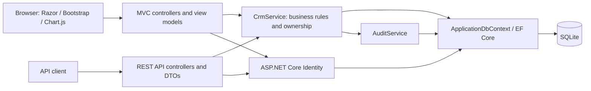

# AcxiomCRM project report

## Purpose and delivered scope

AcxiomCRM manages the sales lifecycle from a new lead to an assigned customer, an opportunity and its follow-up work. The implementation uses **ASP.NET Core MVC on .NET 10**, **ASP.NET Core Identity**, **Entity Framework Core with SQLite**, Razor views, Bootstrap and Chart.js.

The application includes authentication, customer/lead/opportunity CRUD, follow-ups, activities, user administration, an authorized dashboard, eight reports, a read-only audit explorer and cookie-authenticated REST APIs. Bootstrap, Chart.js and validation libraries are bundled locally, so the running UI does not depend on a CDN.

## Architecture

| Location | Responsibility |
| --- | --- |
| `Controllers/` | MVC request handling for CRM, accounts, users, dashboard, reports and audit |
| `Controllers/Api/` | Authentication and CRM JSON endpoints |
| `Models/` | Persisted entities and explicit request/response DTOs |
| `ViewModels/` | Page-specific forms, filters, lists and analytics models |
| `Services/CrmService.cs` | Shared validation, record authorization, CRUD and lead conversion |
| `Services/AuditService.cs` | Sanitized append-only event capture |
| `Data/` | Identity-aware DbContext, relationships, indexes and development seed data |
| `Views/`, `wwwroot/` | Razor pages, responsive UI, client validation and local browser assets |
| `tests/smoke_test.py` | HTTP acceptance checks against a disposable development database |

Both MVC and API writes call the same service. Hiding a navigation item is a convenience; authorization and business rules are enforced again on the server.

## Data model

The CRM entities use EF Core table-per-type mapping. `CrmRecords` contains shared fields (`Id`, `Name`, `Status`, `Notes`, `OwnerId`, `CreatedBy`, `CreatedDate`, `ModifiedDate`); each concrete table contains its additional fields.

| Entity / table | Main additional data and relationships |
| --- | --- |
| `ApplicationUser` / Identity tables | Name, active status and creation time extend `IdentityUser`; Identity manages users, roles, hashes, claims and lockout |
| `Customers` | Generated customer code, email, phone, company, address, city and state |
| `Leads` | Generated lead code, contact/company details, source, priority, expected value and converted customer link |
| `Opportunities` | Customer, optional lead, amount, stage, probability, expected close and actual outcome timestamp |
| `FollowUps` | Customer/lead/opportunity links, date, type and subject; notes hold remarks |
| `Activities` | Optional customer/lead/opportunity links, type, subject, description and activity date |
| `AuditLogs` | Actor, action, module, record ID, before/after values, UTC timestamp, result and IP address |

Customer email, phone and code have unique indexes. Lead codes are unique. Foreign keys restrict deletion of records that are still referenced. Owner/date and audit lookup indexes support common queries. An audit history is retained when an unreferenced CRM record is deleted; converted leads remain read-only.

The application initializes a new database with `EnsureCreatedAsync`. This is convenient for evaluation; schema upgrades for an existing deployment need a planned EF migration strategy. Business date rules use the server's local calendar day; created/modified/outcome/audit timestamps are UTC.

## Authentication and authorization

Identity supplies password hashing and cookie authentication. There is no custom password table. Registration always grants `SalesExecutive`; a submitted role cannot elevate the new account.

| Role | Access |
| --- | --- |
| Admin | All CRM records, dashboard/reports, user and role administration, password reset/unlock and audit |
| Manager | The single configured sales team's CRM records, pipeline and management reports; no user/security administration or full audit view |
| SalesExecutive | Records assigned to that user's Identity ID, related records in that scope and permitted personal reports |

The demonstration models one sales team. It does not implement separate organizations or manager-to-team membership tables. Only active sales executives can own CRM records. Related records must exist in the caller's authorized scope and belong to the selected owner.

Implemented security controls:

- Password policy: at least 10 characters, including uppercase, lowercase, digit and non-alphanumeric characters.
- Lockout: five failed attempts lock an account for 15 minutes. Authentication-sensitive routes also have an IP-based rate limit.
- HttpOnly session cookie, SameSite settings, 30-minute sliding expiration and secure cookies outside Development.
- Server validation of account activity and Identity security stamps; administrative role/status changes invalidate existing sessions.
- Anti-forgery validation on MVC and cookie-authenticated API writes. API clients obtain a request token from `/api/auth/csrf` and send `X-CSRF-TOKEN`.
- Entity Framework parameterized queries, encoded Razor output, browser security headers and safe error messages.
- The final active administrator cannot be demoted or deactivated through user administration.
- DTOs exclude Identity hashes, security stamps and entity navigation data. Audit serialization excludes credential/security fields.

## Validation and CRM workflows

Razor/unobtrusive validation and the CRM browser script provide immediate field feedback. The service repeats critical rules when handling crafted HTTP requests.

| Area | Enforced rules |
| --- | --- |
| Common fields | Required values where applicable; bounded string lengths; allowlisted status, stage, priority and activity type |
| Customer | Required name, valid email and phone; lowercase/trimmed email; unique email and phone |
| Phone | Exactly 10 digits, starting with 6, 7, 8 or 9; this is the configured Indian mobile-number rule |
| Lead | Starts as `New`; expected value from 0 to 999,999,999.99 with at most two decimals; controlled transitions |
| Opportunity | Amount greater than zero and at most 999,999,999.99; at most two decimals; probability 0–100; required customer and close date |
| Active opportunity | Close date cannot precede today; stage and status must agree |
| Follow-up | Required subject/date/type/status and at least one related record; a new or planned follow-up cannot be dated before today |
| Ownership / relationships | Referenced IDs and owners are checked server-side; sales users cannot assign records to another user |

**Lead conversion:** `New → Contacted → Qualified → Convert to customer`. Qualification cannot be skipped. Alternative transitions support lost/unqualified leads and reopening them as New. Conversion creates a customer, preserves the owner, links the original lead and records audit events in one database transaction. Duplicate contact details and repeated conversion are rejected. An opportunity can then be created against the resulting customer; conversion does not automatically create an opportunity.

**Opportunity:** active stages are Qualification, Proposal and Negotiation. Won and Lost are final outcomes; they set probability to 100 and 0 respectively and record `ClosedDate`. Reopening clears that outcome timestamp. Weighted pipeline is `Amount × Probability / 100` for open opportunities.

**Follow-up/activity:** users schedule calls, meetings, emails and tasks, record notes, reschedule and mark work completed. The dashboard highlights pending and overdue follow-ups. Notifications are in-app reminders; no email or background reminder delivery is implemented.

## Dashboard and reporting

The dashboard calculates eight required KPIs: total customers, total leads, open leads, total opportunities, open opportunities, won opportunities, lost opportunities and total open pipeline value. It also shows weighted pipeline, pending/overdue follow-ups, recent leads and administrator activity indicators.

The three Chart.js charts show lead status, opportunity amount by stage and monthly won/lost amounts using the recorded outcome date. Today, week, month and custom-range filters select records by creation date. Pending follow-up reminders remain visible across all dates. All dashboard datasets first pass through the same role/owner scope used by CRM lists.

| Report | Content | Date filter basis |
| --- | --- | --- |
| Customers | Contact details, status, owner and creation date | Creation date |
| Leads | Source, priority, status, expected value and converted customer | Creation date |
| Opportunities | Stage, status, amount, probability and weighted amount | Expected close date |
| Follow-ups | Schedule, completion status, overdue flag and related IDs | Follow-up date |
| Sales pipeline | Open opportunity counts and amounts grouped by stage and owner | Expected close date |
| Sales & conversion | Lead conversion rates, open/won/lost counts and won revenue by owner | Record creation date |
| User activity | Audited action counts by user and module; managers receive business actions only | Event date |
| Audit events | Security and business event summary; Admin only | Event date, UTC |

Reports provide text/owner/status filters, sortable columns, pagination and CSV export of all matching rows. CSV exports preserve authorization and neutralize formula-leading cells. Audit Log additionally supports module, actor, action and date filters, with expandable before/after details.

## REST API

The APIs use the same Identity cookie as the MVC application. Acquire an anonymous CSRF token before login, retain cookies, then fetch a fresh CSRF token after login for subsequent writes.

| Endpoint | Operations |
| --- | --- |
| `/api/auth/csrf`, `/api/auth/me` | Request token; inspect signed-in user |
| `/api/auth/login`, `/api/auth/logout` | POST login/logout |
| `/api/{kind}` | GET filtered/paginated records; POST create |
| `/api/{kind}/{id}` | GET details; PUT full update; DELETE |
| `/api/leads/{id}/convert` | POST qualified lead conversion |
| `/api/owners` | GET authorized assignment choices |
| `/api/reports/pipeline` | GET scoped pipeline summary |

Valid kinds are `customers`, `leads`, `opportunities`, `followups` and `activities`. Responses use appropriate success/error statuses, including 200, 201, 204, 400, 401, 403, 404, 409 and 429. Missing or out-of-scope records are not disclosed as readable resources. Input DTOs do not permit the caller to set generated IDs, creator or audit timestamps.

## Audit design

Create/update/delete, lead conversion, status changes, follow-up rescheduling, login/logout/failures, registration and account-administration events are captured. CRM writes and their audit entries share a transaction. Application-level change tracking and SQLite triggers reject audit updates/deletes. This protects the application's append-only history; it is not an external tamper-evident logging service.

## Verification and practical limits

The recorded acceptance run passed **133 of 133 HTTP checks**. Coverage includes protected pages, all three roles, record ownership, CRUD, invalid/tampered input, lead conversion, opportunity/follow-up rules, report access/export, audit output, HTML encoding, CSV formula protection, registration, logout and lockout. The project was also compiled successfully.

**Browser visual QA is not finished.** HTTP rendering checks and bundled script availability do not prove browser layout, chart rendering, keyboard interaction or every client-validation interaction. These remain manual checks for the evaluator; no completed visual inspection is claimed.

The implementation is an assignment/demo baseline. It uses SQLite and materializes authorized record lists before some filtering/aggregation; larger deployments should add database-side aggregation/pagination and operational testing. Production also needs HTTPS/domain configuration, protected deployment secrets, backups, persistent Data Protection keys, a migration plan and environment-specific monitoring. Demo credentials/data are seeded only in Development. No live hosting or email reset delivery is claimed.

See [Demo guide](DEMO_GUIDE.md) for setup and a five-minute walkthrough.
